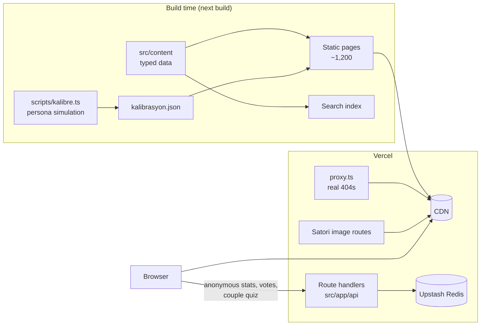

# Sosyal Eğlence

[](https://github.com/omersemihuzun/sosyaleglence/actions/workflows/ci.yml)

A Turkish-language entertainment platform for couples and friends: calibrated personality tests, photo-based
elimination games, live polls, couple games, zodiac compatibility and a gift finder.

**Live:** [sosyaleglence.com](https://sosyaleglence.com)

Built with Next.js 16 (App Router, Cache Components), React 19, TypeScript, Tailwind CSS 4 and Upstash Redis, deployed
on Vercel.

## Highlights

- **About 1,200 statically generated pages** with real 404s for personal routes, per-page Open Graph images and
  structured data (FAQ, Breadcrumb, Article). LCP is under 1 second on mobile.
- **A calibrated scoring engine.** Tests are multi-dimensional, and results are chosen by the nearest calibrated profile.
  Profiles come from a seeded persona simulation, so they are deterministic and CI checks them byte for byte. Quality
  metrics such as accuracy, noise robustness, answer transparency, dead options and length tells keep the questions
  hard to game.
- **Privacy-first realtime features.** Anonymous counters, live poll results, and a link-based couple quiz whose answers
  never reach the guesser's browser: the server scores the guesses. Share codes are 64-bit random and reads and writes
  are rate-limited per IP.
- **Shareable output.** Story cards (1080×1920) and link previews are rendered with Satori on the server, or with Canvas
  in the browser when the input is personal, such as names.
- **Quality gates on every push:** formatting, lint, types, dead-code detection, about 320 unit and content-integrity
  tests, calibration, SEO length checks, a dependency audit, a production build and about 120 Playwright end-to-end
  tests on desktop and mobile, including axe accessibility scans.

## Features

| Area               | Route                       | What it does                                                                               |
| ------------------ | --------------------------- | ------------------------------------------------------------------------------------------ |
| Personality tests  | `/testler`                  | 20 scenario tests with calibrated results, shareable score links and two-person comparison |
| Couple games       | `/cift-oyunlari`            | "How well do you know me?" over a link, conversation cards, truth or dare, date-idea wheel |
| Elimination games  | `/eleme`                    | 20 sixteen-item brackets illustrated with about 300 openly licensed photos                 |
| This or that       | `/bunu-mu-o-mu`             | 40 polls in 10-question rounds, with vote changes, skipping and a round summary            |
| Zodiac             | `/burclar`, `/burc-uyumu/…` | 12 sign profiles and 78 pair pages                                                         |
| Name compatibility | `/ask-testi`                | Deterministic, order-independent score computed entirely in the browser                    |
| Gifts and guides   | `/hediye`, `/rehber`        | Gift finder with 100 ideas, 18 buying guides and 16 long-form articles                     |
| Search             | `/ara`                      | Accent- and case-insensitive Turkish search over a prebuilt index                          |

## Architecture



**Principles**

- **Content is data.** Everything editorial lives in `src/content` as typed TypeScript modules, and unit tests enforce
  its integrity: unique ids, licenses, power-of-two bracket sizes, calibration coverage. Pages are thin renderers.
- **Static first.** Pages are prerendered. Interactive parts that start in a random state (shuffled decks, the wheel)
  render only in the browser to avoid hydration mismatches, while titles, descriptions and FAQs stay in the HTML.
- **The server is the source of truth for anything competitive.** Answers to the couple quiz are stored on the server
  and revealed only after the guesses are scored. The client receives the questions only.
- **Graceful degradation.** Without Redis credentials the site still builds and runs. Stats, polls and comparisons
  simply hide.
- **Domain language is Turkish.** Product terms (`testler`, `eleme`, `cift`, `burc`) are kept in Turkish in routes,
  content and feature folders. Infrastructure code uses English.

## Project structure

```
src/
  app/                 Routes (App Router), metadata, OG images, API route handlers
    api/               Stats, polls, comparison, couple quiz, story-card endpoints
  components/
    layout/            Header, navigation, mobile menu, footer, search box
    shared/            Share bar, live stats, celebration
    tests/ brackets/ polls/ gifts/ articles/ burc/ cift/ isim-uyumu/
                       Feature components, one folder per product area
  content/             Typed editorial data: tests, brackets (+ photo credits), polls, gifts, articles, zodiac, couple games
  lib/
    scoring.ts         Dimension scores, nearest-profile result, score encoding
    bracket.ts         Tournament state derived from the pick history
    taniyor.ts         Couple quiz validation, scoring and ownership hashing
    og/                Satori story cards and link previews
    server/            Redis client, rate limiting, request helpers (server-only)
    client/            Browser-only helpers (stats beacons, canvas cards)
  proxy.ts             Validates personal routes before render (real 404s)
scripts/               Calibration, SEO audit, live report, photo sourcing tools
e2e/                   Playwright specs (desktop + mobile, a11y, SEO over the sitemap)
docs/                  Operations, security, test metrics, content guides (Turkish)
```

## Getting started

Requires Node.js 22.6 or later (CI uses Node 24).

```bash
npm ci
npm run dev            # http://localhost:3000
```

Redis is optional locally. To use the shared database, link the Vercel project and pull the environment:

```bash
vercel link && vercel env pull .env.local --yes
```

| Variable                               | Purpose                                                          |
| -------------------------------------- | ---------------------------------------------------------------- |
| `NEXT_PUBLIC_SITE_URL`                 | Canonical origin (defaults to `https://sosyaleglence.com`)       |
| `KV_REST_API_URL`, `KV_REST_API_TOKEN` | Upstash Redis, provisioned by the Vercel Marketplace integration |
| `NEXT_PUBLIC_AMAZON_TAG`               | Optional affiliate tag for gift links                            |

## Scripts

| Command           | Description                                                                                   |
| ----------------- | --------------------------------------------------------------------------------------------- |
| `npm run check`   | Everything that runs before a commit: format, lint, types, knip, unit tests, calibration, SEO |
| `npm run build`   | Production build                                                                              |
| `npm run e2e`     | Playwright end-to-end tests against the production build                                      |
| `npm test`        | Vitest unit and content-integrity tests                                                       |
| `npm run kalibre` | Calibrate test profiles and regenerate `docs/test-metrikleri.md`                              |
| `npm run seo`     | Title and description length audit for content-driven pages                                   |
| `npm run rapor`   | Live report: completion funnel, real option distribution, poll results                        |
| `npm run knip`    | Unused files, exports and dependencies                                                        |

## Engineering practices

- **CI** (`.github/workflows/ci.yml`) runs the full check, `npm audit --omit=dev`, a production build and the e2e
  suite. Dependabot opens weekly grouped update PRs.
- **Branches.** All work happens on a branch and lands on `main` through a pull request.
- **Formatting.** Prettier, LF line endings (`.gitattributes`) and `.editorconfig`. The one-time formatting commit is
  listed in `.git-blame-ignore-revs`.
- **Security.** CSP, HSTS and frame denial; strict input allow-lists on every endpoint; body-size limits; per-IP rate
  limits; Unicode-sanitised user names; escaped JSON-LD. See [`docs/guvenlik.md`](docs/guvenlik.md).
- **Accessibility.** Axe scans on key pages, keyboard support in games, `prefers-reduced-motion` handling and touch
  targets of at least 24px.

## Documentation

| Document                                             | Topic                                                |
| ---------------------------------------------------- | ---------------------------------------------------- |
| [`docs/icerik-ekleme.md`](docs/icerik-ekleme.md)     | Adding a test, an elimination game or photos         |
| [`docs/test-metrikleri.md`](docs/test-metrikleri.md) | Generated test-quality report and metric definitions |
| [`docs/guvenlik.md`](docs/guvenlik.md)               | Security controls, accepted risks, review checklist  |
| [`docs/operasyon.md`](docs/operasyon.md)             | Deployment, environment, monitoring                  |
| [`docs/domain-gecisi.md`](docs/domain-gecisi.md)     | DNS cut-over from the previous hosting               |
| [`docs/erisilebilirlik.md`](docs/erisilebilirlik.md) | Accessibility audit                                  |
| [`docs/icerik-denetimi.md`](docs/icerik-denetimi.md) | Editorial audit                                      |
| [`docs/rakip-analizi.md`](docs/rakip-analizi.md)     | Competitor analysis                                  |

## License

The source code and editorial content are © Ömer Semih Uzun, all rights reserved (see [`LICENSE`](LICENSE)). Photos in
`public/eleme` are third-party works under CC0, public domain, CC BY or CC BY-SA. Each one is credited on
[the photo credits page](https://sosyaleglence.com/gorsel-kaynaklari) and in `src/content/brackets/gorseller`.
