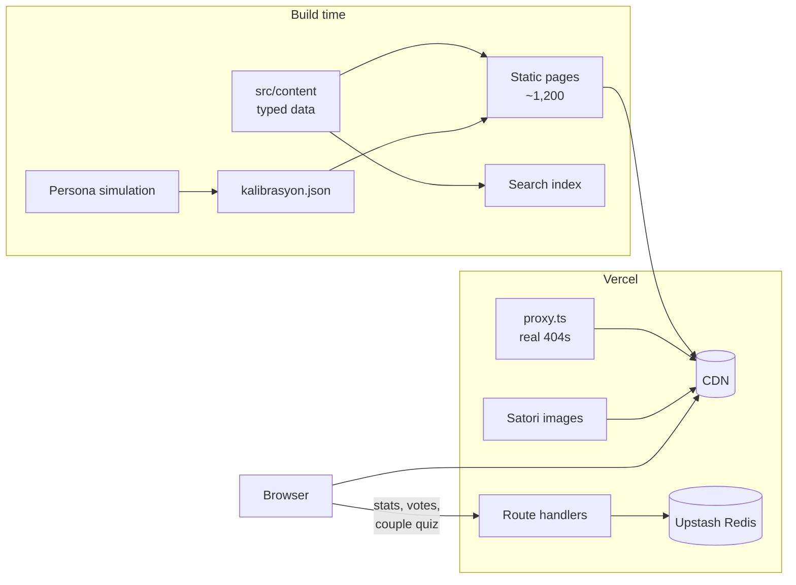

<div align="center">

# Sosyal Eğlence

**Calibrated personality tests, couple games and elimination games for Turkish audiences.**<br>
**Türkçe kitle için kalibre edilmiş kişilik testleri, çift oyunları ve eleme oyunları.**

[](https://sosyaleglence.com)
[](https://github.com/omersemihuzun/sosyaleglence/actions/workflows/ci.yml)


</div>

<details open>
<summary><b>🇬🇧 English</b></summary>

## Overview

Sosyal Eğlence replaces a WordPress site with a Next.js 16 platform: about 1,200 statically generated pages, realtime
features on Upstash Redis and strict quality gates in CI. It runs on Vercel at
[sosyaleglence.com](https://sosyaleglence.com).

**Stack:** Next.js 16 (App Router, Cache Components) · React 19 · TypeScript · Tailwind CSS 4 · Upstash Redis · Vercel ·
Vitest · Playwright

## Highlights

- **Calibrated scoring engine.** Tests are multi-dimensional, and each result is the nearest calibrated profile.
  Profiles come from a seeded persona simulation, so they are deterministic and CI checks them byte for byte. Quality
  metrics such as accuracy, noise robustness, answer transparency, dead options and length tells keep the questions
  hard to game.
- **Privacy-first realtime features.** Anonymous counters, live polls, and a link-based couple quiz whose answers never
  reach the guesser's browser: the server scores the guesses. Share codes are 64-bit random and every endpoint is
  rate-limited per IP.
- **Shareable output.** Story cards (1080×1920) and link previews are rendered with Satori on the server, or with Canvas
  in the browser when the input is personal, such as names.
- **Static first, fast.** Personal routes return real 404s, every page has Open Graph images and structured data, and
  LCP is under 1 second on mobile.
- **Quality gates on every push:** formatting, lint, types, dead-code detection, about 320 unit and content-integrity
  tests, calibration, SEO checks, a dependency audit, a production build and about 120 Playwright tests on desktop and
  mobile, including axe accessibility scans.

## Features

| Area               | Route                       | What it does                                                                               |
| ------------------ | --------------------------- | ------------------------------------------------------------------------------------------ |
| Personality tests  | `/testler`                  | 20 scenario tests with calibrated results, shareable score links and two-person comparison |
| Couple games       | `/cift-oyunlari`            | "How well do you know me?" over a link, conversation cards, truth or dare, date-idea wheel |
| Elimination games  | `/eleme`                    | 20 sixteen-item brackets illustrated with about 300 openly licensed photos                 |
| This or that       | `/bunu-mu-o-mu`             | 40 polls in 10-question rounds, with vote changes, skipping and a round summary            |
| Zodiac             | `/burclar`, `/burc-uyumu/…` | 12 sign profiles and 78 pair pages                                                         |
| Name compatibility | `/ask-testi`                | Deterministic, order-independent score computed entirely in the browser                    |
| Gifts and guides   | `/hediye`, `/rehber`        | Gift finder with 100 ideas, 18 buying guides and 16 long-form articles                     |
| Search             | `/ara`                      | Accent- and case-insensitive Turkish search over a prebuilt index                          |

## Architecture



- **Content is data.** Everything editorial lives in `src/content` as typed modules. Unit tests enforce unique ids,
  photo licenses, bracket sizes and calibration coverage, so pages stay thin renderers.
- **Static first.** Parts that start in a random state, such as shuffled decks and the wheel, render only in the browser.
  Titles, descriptions and FAQs stay in the HTML.
- **The server owns anything competitive.** Couple-quiz answers are stored on the server and revealed only after the
  guesses are scored.
- **Graceful degradation.** Without Redis credentials the site still builds and runs. Stats and comparisons hide.
- **Domain language is Turkish.** Product terms (`testler`, `eleme`, `cift`, `burc`) stay Turkish in routes, content and
  feature folders. Infrastructure code is in English.

## Project structure

```
src/
  app/              Routes, metadata, OG images, API route handlers
  components/       layout/ · shared/ · one folder per product area (tests, brackets, cift, polls, …)
  content/          Typed editorial data
  lib/              scoring · bracket · taniyor (couple quiz) · og/ (Satori + fonts) · server/ · client/
  proxy.ts          Validates personal routes before render
scripts/            Calibration, SEO audit, live report, photo sourcing
e2e/                Playwright specs: desktop + mobile, a11y, sitemap-wide SEO
docs/               Operations, security, test metrics, content guides (Turkish)
```

## Getting started

Requires Node.js 22.6 or later.

```bash
npm ci
npm run dev                                   # http://localhost:3000
vercel link && vercel env pull .env.local     # optional: shared Redis
```

| Command           | Description                                                                 |
| ----------------- | --------------------------------------------------------------------------- |
| `npm run check`   | Format, lint, types, knip, unit tests, calibration and SEO, before a commit |
| `npm run build`   | Production build                                                            |
| `npm run e2e`     | Playwright tests against the production build                               |
| `npm run kalibre` | Calibrate test profiles and regenerate `docs/test-metrikleri.md`            |
| `npm run rapor`   | Live report: completion funnel, option distribution, poll results           |

| Variable                               | Purpose                                                    |
| -------------------------------------- | ---------------------------------------------------------- |
| `NEXT_PUBLIC_SITE_URL`                 | Canonical origin (defaults to `https://sosyaleglence.com`) |
| `KV_REST_API_URL`, `KV_REST_API_TOKEN` | Upstash Redis, provisioned through the Vercel Marketplace  |

## Engineering practices

- **Workflow.** Work happens on branches and lands on `main` through pull requests. CI must pass first. Merges to `main`
  deploy to production, and every pull request gets a preview deployment.
- **CI** runs `npm run check`, `npm audit --omit=dev`, a production build and the e2e suite. Dependabot opens weekly
  grouped updates.
- **Security.** CSP and HSTS, input allow-lists, body-size limits, per-IP rate limits, Unicode-sanitised names and
  escaped JSON-LD. See [`docs/guvenlik.md`](docs/guvenlik.md).
- **Accessibility.** Axe scans, keyboard support in games, reduced-motion handling and touch targets of at least 24px.

</details>

<details>
<summary><b>🇹🇷 Türkçe</b></summary>

## Genel bakış

Sosyal Eğlence, eski WordPress sitesinin yerini alan bir Next.js 16 platformudur. Yaklaşık 1.200 statik sayfa üretir,
gerçek zamanlı özellikleri Upstash Redis üzerinde çalışır ve CI'da sıkı kalite kapılarından geçer.
[sosyaleglence.com](https://sosyaleglence.com) adresinde Vercel'de yayındadır.

**Teknolojiler:** Next.js 16 (App Router, Cache Components) · React 19 · TypeScript · Tailwind CSS 4 · Upstash Redis ·
Vercel · Vitest · Playwright

## Öne çıkanlar

- **Kalibre puanlama motoru.** Testler çok boyutludur. Sonuç, kişinin puanlarına en yakın kalibre profildir. Profiller
  sabit tohumlu bir sanal kişi simülasyonundan gelir; bu yüzden belirlidirler ve CI onları bire bir doğrular. İsabet,
  gürültüye dayanıklılık, şık şeffaflığı, ölü şık ve uzunluk ipucu metrikleri soruların kolay tahmin edilmesini önler.
- **Gizlilik öncelikli gerçek zamanlı özellikler.** Anonim sayaçlar, canlı anketler ve link ile oynanan bir çift testi
  var. Çift testinde cevaplar tahmin edenin tarayıcısına hiç gitmez; puanı sunucu hesaplar. Paylaşım kodları 64 bit
  rastgeledir, her uçta IP başına hız sınırı uygulanır.
- **Paylaşılabilir çıktılar.** Story kartları (1080×1920) ve bağlantı önizlemeleri sunucuda Satori ile üretilir. İsim
  gibi kişisel bir girdi varsa kart tarayıcıda Canvas ile çizilir.
- **Önce statik, hızlı.** Kişiye özel adresler gerçek 404 döner, her sayfanın OG görseli ve yapılandırılmış verisi
  vardır, mobilde LCP 1 saniyenin altındadır.
- **Her push'ta kalite kapıları:** biçim, lint, tipler, ölü kod taraması, yaklaşık 320 birim ve içerik bütünlüğü testi,
  kalibrasyon, SEO denetimi, bağımlılık taraması, production build ve masaüstü ile mobilde yaklaşık 120 Playwright testi
  (axe erişilebilirlik taramaları dahil).

## Özellikler

| Alan             | Adres                       | Ne yapar                                                                                     |
| ---------------- | --------------------------- | -------------------------------------------------------------------------------------------- |
| Kişilik testleri | `/testler`                  | Kalibre sonuçlu 20 senaryo testi, paylaşılabilir skor linkleri, iki kişilik karşılaştırma    |
| Çift oyunları    | `/cift-oyunlari`            | Link ile "Beni ne kadar tanıyorsun?", sohbet kartları, doğruluk mu cesaret mi, randevu çarkı |
| Eleme oyunları   | `/eleme`                    | Yaklaşık 300 açık lisanslı fotoğrafla 16 seçenekli 20 turnuva                                |
| Bunu mu O mu?    | `/bunu-mu-o-mu`             | 10 soruluk turlarda 40 anket; fikir değiştirme, atlama ve tur özeti                          |
| Burçlar          | `/burclar`, `/burc-uyumu/…` | 12 burç profili ve 78 uyum sayfası                                                           |
| İsim uyumu       | `/ask-testi`                | Tamamen tarayıcıda hesaplanan, sıradan bağımsız, sabit sonuçlu puan                          |
| Hediye ve rehber | `/hediye`, `/rehber`        | 100 fikirli hediye bulucu, 18 alışveriş rehberi ve 16 uzun makale                            |
| Arama            | `/ara`                      | Hazır indeks üzerinde Türkçe karakter ve büyük/küçük harf duyarsız arama                     |

## Mimari

Diyagram İngilizce bölümde. İlkeler:

- **İçerik veridir.** Bütün içerik `src/content` altında tipli modüllerdir. Birim testler benzersiz id'leri, fotoğraf
  lisanslarını, turnuva boyutlarını ve kalibrasyon kapsamını denetler; sayfalar yalnızca çizim yapar.
- **Önce statik.** Karışık deste ve çark gibi rastgele başlayan parçalar sadece tarayıcıda çizilir. Başlık, açıklama ve
  SSS HTML'de kalır.
- **Rekabet içeren her şeyin sahibi sunucudur.** Çift testinin cevapları sunucuda tutulur ve tahminler puanlandıktan
  sonra açılır.
- **Zarif düşüş.** Redis bilgileri yoksa site yine derlenir ve çalışır; istatistik ve karşılaştırmalar gizlenir.
- **Alan dili Türkçedir.** Ürün terimleri (`testler`, `eleme`, `cift`, `burc`) adreslerde, içerikte ve özellik
  klasörlerinde Türkçe kalır. Altyapı kodu İngilizcedir.

## Başlangıç

Node.js 22.6 veya üstü gerekir.

```bash
npm ci
npm run dev                                   # http://localhost:3000
vercel link && vercel env pull .env.local     # isteğe bağlı: ortak Redis
```

| Komut             | Açıklama                                                                   |
| ----------------- | -------------------------------------------------------------------------- |
| `npm run check`   | Commit öncesi: biçim, lint, tipler, knip, birim testleri, kalibrasyon, SEO |
| `npm run build`   | Production build                                                           |
| `npm run e2e`     | Production build üzerinde Playwright testleri                              |
| `npm run kalibre` | Test profillerini kalibre et, `docs/test-metrikleri.md` raporunu üret      |
| `npm run rapor`   | Canlı rapor: tamamlama hunisi, şık dağılımı, anket sonuçları               |

## Çalışma düzeni

- **İş akışı.** İş dallarda yapılır ve CI geçtikten sonra pull request ile `main`'e alınır. `main`'e gelen her şey
  otomatik olarak yayına çıkar; her PR için bir önizleme adresi oluşur.
- **Güvenlik.** CSP ve HSTS, girdi beyaz listeleri, gövde boyutu ve IP başına hız sınırları, Unicode temizliği ve
  kaçırılmış JSON-LD kullanılır. Ayrıntılar [`docs/guvenlik.md`](docs/guvenlik.md) dosyasında.
- **İçerik ekleme.** Yeni test, eleme oyunu ve fotoğraf eklemek için [`docs/icerik-ekleme.md`](docs/icerik-ekleme.md)
  dosyasına bakın.

</details>

## Documentation · Dokümanlar

| Document · Doküman                                   | Topic · Konu                                                                          |
| ---------------------------------------------------- | ------------------------------------------------------------------------------------- |
| [`docs/icerik-ekleme.md`](docs/icerik-ekleme.md)     | Adding content · İçerik ekleme                                                        |
| [`docs/test-metrikleri.md`](docs/test-metrikleri.md) | Generated test-quality report · Test kalite raporu                                    |
| [`docs/guvenlik.md`](docs/guvenlik.md)               | Security · Güvenlik                                                                   |
| [`docs/operasyon.md`](docs/operasyon.md)             | Operations · Operasyon                                                                |
| [`docs/erisilebilirlik.md`](docs/erisilebilirlik.md) | Accessibility audit · Erişilebilirlik denetimi                                        |
| [`docs/arsiv/`](docs/arsiv)                          | Past reports: domain cut-over, editorial audit, competitor analysis · Geçmiş raporlar |

## License · Lisans

© Ömer Semih Uzun. All rights reserved; see [`LICENSE`](LICENSE). Photos in `public/eleme` are third-party works under
CC0, public domain, CC BY or CC BY-SA, credited on [the photo credits page](https://sosyaleglence.com/gorsel-kaynaklari).

© Ömer Semih Uzun. Tüm hakları saklıdır. `public/eleme` altındaki fotoğraflar CC0, kamu malı, CC BY veya CC BY-SA
lisanslıdır ve hepsi [görsel kaynakları sayfasında](https://sosyaleglence.com/gorsel-kaynaklari) belirtilmiştir.
